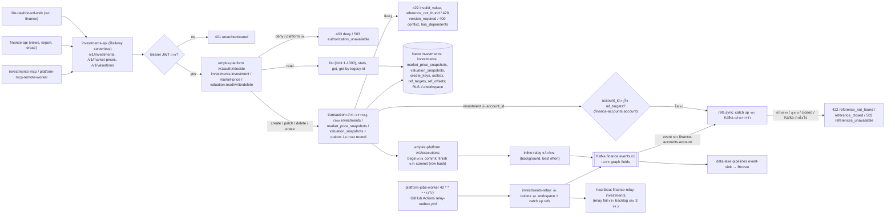

# 01 — Business process (As-Is / To-Be)

finance-investments-api (cell `investments`) เก็บการลงทุนที่ถืออยู่ ราคาตลาดที่เห็นของแต่ละ instrument และ valuation ตามวันของแต่ละการลงทุน ต่อ scope; `account_id` ชี้ไปที่ account ใน `finance-accounts-api` และ owner ใช้ผ่าน `life-dashboard-web`, `finance-api` และ MCP

Last reviewed: 2026-11-27 · commit `34d72b2`

## As-Is (จากโค้ดวันนี้)

Sources: `cell.yaml`, `pyproject.toml` (platform-cellkit v1.1.1: `cellkit/app.py`, `cellkit/refs.py`, `cellkit/relay.py`, `cellkit/gateway.py`), `migrations/0001_investments.sql`–`0004_cross_references.sql`, `.github/workflows/relay-outbox.yml`, `.railway/railway.ts`, `README.md`, `PRODUCT.md`, `specs/006-cross-service-references/spec.md`

ข้อเท็จจริงสำคัญจากโค้ด:

- โค้ดของ cell มีแค่ `cell.yaml`; route, auth, outbox, refs และ relay มาจาก platform-cellkit v1.1.1 (`src/solo_investments/` ว่าง)
- investment: `name` (ไม่เกิน 200 ตัว) และ `investment_type` บังคับ; `status` ค่าเริ่มต้น active; `quantity` (`decimal`), `cost_basis`, `current_value` (`money`) ติดลบไม่ได้; `instrument_key` ไม่เกิน 160 ตัว; `account_id` (`references: finance-accounts.account`, `refuse_status: [closed]`) ถูกตรวจกับสำเนาที่มาจาก event (SPEC-006)
- market-price: `instrument_key`, `price`, `as_of`, `source_type` บังคับ; `quality` ค่าเริ่มต้น provisional; หนึ่งราคาต่อ instrument + `as_of` + `source_type` (409)
- valuation: `investment_id`, `valuation_as_of`, `valuation_method` บังคับ; `investment_id` และ `market_price_id` เป็น foreign key ภายในฐานข้อมูลเดียวกัน (422 `reference_not_found`); หนึ่ง valuation ต่อ investment ต่อเวลา (409); investment หรือ market price ที่ valuation ยังชี้อยู่ลบไม่ได้ (409 `has_dependents`) และ erase จะข้ามไว้
- PATCH ที่ส่งฟิลด์เงิน (`cost_basis`, `current_value`, `market_value`) ต้องมี `expected_version` (428, SPEC-009)
- event (เฉพาะ graph fields, ไม่มียอดเงิน ราคา จำนวน ชื่อ หรือ notes): `investments.investment.*` = `investment_type`, `scope`, `account_id`, `currency`, `acquired_on`, `status`; `investments.market-price.*` = `currency`, `source_type`, `quality`; `investments.valuation.*` = `investment_id`, `market_price_id`, `currency`, `valuation_method`, `coverage_status`
- investment ไม่มี `referenced_by` ข้าม cell: ลบได้โดยไม่ต้องรอ cell อื่น ถ้าไม่มี valuation ชี้อยู่
- ไม่มีโค้ดใน repo นี้ที่ดึงราคาหรือเขียน `market-price` / `valuation` ตามรอบ [ต้องยืนยัน: job หรือคนที่เขียน]
- `POST /v1/<plural>/erase` ต้องมี `confirm` = workspace ของผู้เรียก ลบทีละ 1-500 แถว (ค่าเริ่มต้น 200; SPEC-008)
- การตรวจ `X-Gateway-Assertion` (off/report/enforce), inline relay และ `INVESTMENTS_REFS_DATABASE_URL` ขึ้นกับตัวแปรบน Railway [ต้องยืนยัน: ค่าใน production]

## To-Be (จาก `PRODUCT.md` §Measures และ `specs/004-identity-issuer-trust/spec.md`)

- `specs/004-identity-issuer-trust/spec.md`: cell เชื่อ token ของ platform-identity เคียงข้าง empire-platform; โค้ดอยู่ใน kit แล้ว แต่ "production activation needs a separate owner go"
- `PRODUCT.md` §Measures (Proposed, ยังไม่มีอะไรเก็บ): สัดส่วนการลงทุน active ที่ valuation ล่าสุด covered, มูลค่าปัจจุบันและต้นทุนรวมต่อสกุลเงิน (dashboard แสดงอยู่แล้ว), 5xx และ p95 latency ของ `/v1/investments`
- `PRODUCT.md` §Capabilities: out of scope = การดึงราคาจากตลาด, กำไรขาดทุน และ tax lots; ไม่ตรวจว่าราคาของ valuation เป็น instrument เดียวกับการลงทุน

## Gap

| ID | As-Is → To-Be | Status | Owner | Evidence |
|---|---|---|---|---|
| G1 | รับ token ของ platform-identity ได้ในโค้ด แต่ยังไม่ยืนยันว่าเปิดใน production → owner ตัดสินเปิดใช้ (ตั้ง `INVESTMENTS_JWT_IDENTITY_*`) | decide | owner | `specs/004-identity-issuer-trust/spec.md` (Status) |
| G2 | ไม่มีอะไรเก็บ Measures ที่เสนอไว้ → เก็บและรายงานตาม `PRODUCT.md` | decide | owner | `PRODUCT.md` §Measures ("Proposed (nothing collects them yet)") |
| G3 | ไม่มีอะไรใน repo เขียน market-price / valuation ตามรอบ → measure "valuation ล่าสุด covered" ต้องมีแหล่งเขียน valuation | decide | owner | `PRODUCT.md` §Users [ต้องยืนยัน]; §Capabilities (out of scope: fetching prices) |

## Open questions

- `PRODUCT.md` §Capabilities ยังเขียนว่า `account_id` "a plain number, not a foreign key" แต่โค้ดวันนี้ (SPEC-006) ตรวจและปฏิเสธ account ที่ไม่มีหรือปิดแล้ว; ควรแก้ `PRODUCT.md`
- `finance-ledger-core` (`book-finance-api`) อ่าน `/v1/valuations` และ `/v1/market-prices` จริงหรือไม่ (PRODUCT.md ระบุ `[ต้องยืนยัน]`)
- โหมด gateway assertion และ signed events (`INVESTMENTS_EVENT_SIGNATURES`) ใน production เป็นค่าใด
